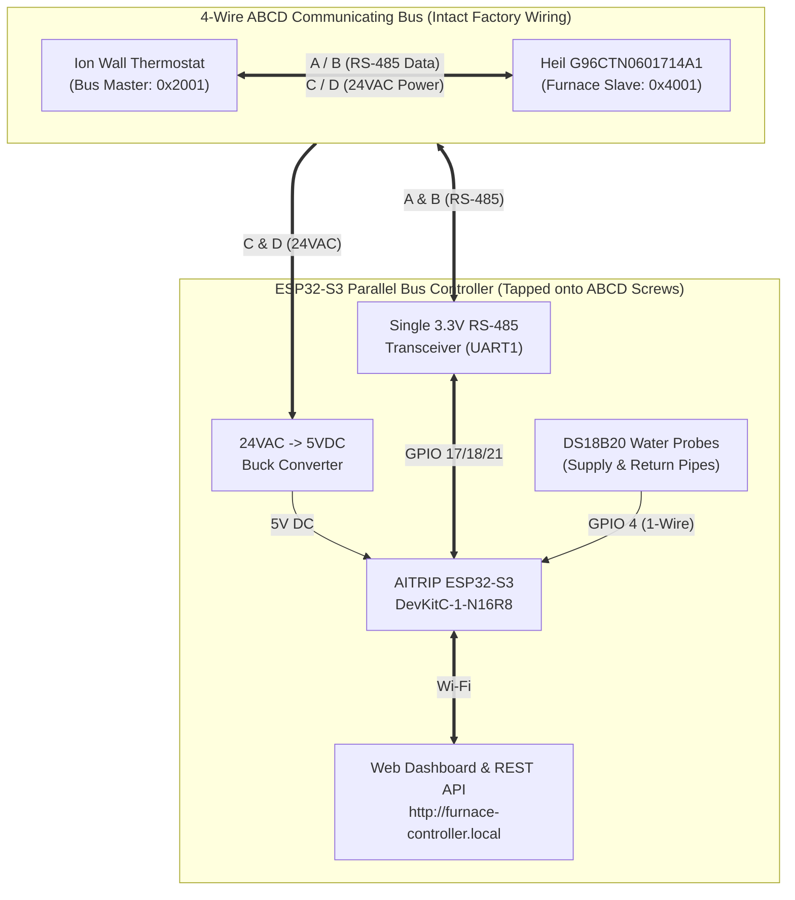
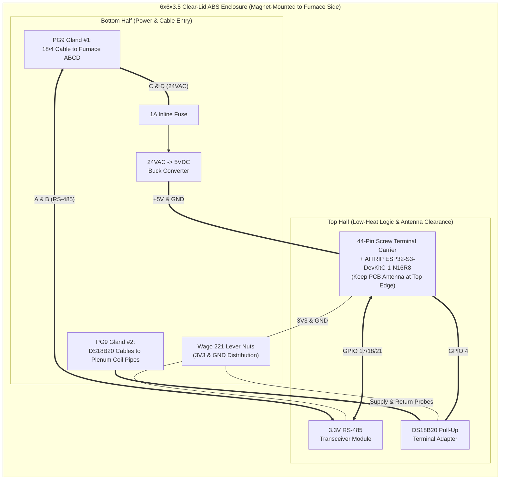
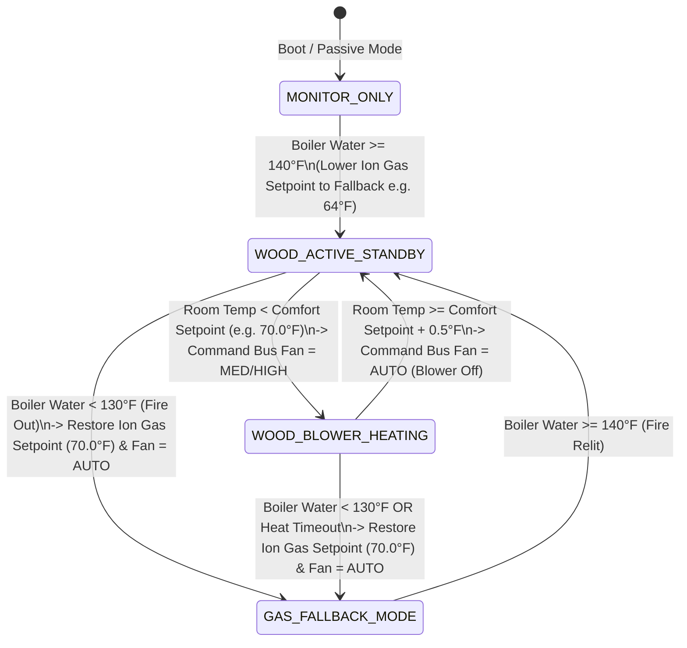
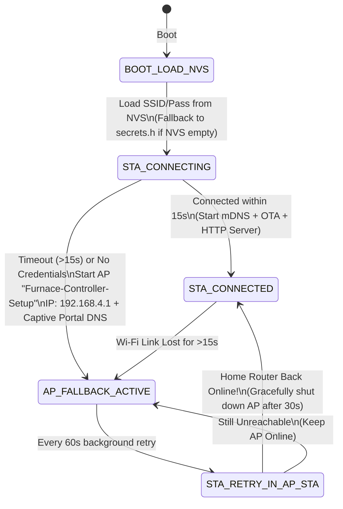

# Implementation Plan: Heil `G96CTN0601714A1` Ion Communicating Furnace & Wood Boiler Controller

## 1. Furnace Data Plate Analysis

From your rating plate, here are the key specifications of your furnace and what they mean for our controller design:

| Parameter | Value from Data Plate | Control Architecture Impact |
| :--- | :--- | :--- |
| **Manufacturer** | International Comfort Products (ICP / Carrier Global) | Uses the **Carrier/ICP 4-wire ABCD (`RS-485` + `24VAC`)** communicating bus protocol (`38400 baud, 8N1, 16-bit CRC`). |
| **Model Number** | **`G96CTN0601714A1`** (QuietComfort 96 Series, Mfg `DEC 2021`) | • `96` = 96% AFUE condensing gas furnace • `CTN` = **Communicating Two-Stage** (`HI` / `LO` gas valve) with **Variable-Speed Constant-Torque / Constant-Airflow ECM Blower** (`1/2 HP, 373W`) • `060` = 60,000 BTU/hr High Fire (`39,000 BTU/hr` Low Fire) • `17` = 17.5" Cabinet, `14` = ~1,400 CFM nominal airflow |
| **Model Plug** | `HK70EZ089` (`Pin 1-4: 39 kΩ`, `Pin 2-3: 91 kΩ`) | Identifies the 60k BTU 2-stage table profile to the furnace control board (`0x4001` / `0x4002` on the ABCD bus). |
| **Heating Stages** | **2-Stage Gas** (`LO: 38,000 BTU/hr out`, `HI: 58,000 BTU/hr out`) | Discrete states (`OFF`, `STAGE 1 LO`, `STAGE 2 HI`) plus ECM blower speed (`Off`, `Low`, `Med`, `High` / target CFM). |

---

## 2. Primary Architecture: Parallel ABCD Bus Co-Controller (Peer Device)

Instead of cutting the thermostat wires and sitting in the middle, the **ESP32-S3 connects in parallel as a peer device on the 4-wire ABCD bus** (just like a Carrier/ICP System Access Module, `SAM`):

### Why Parallel Peer Mode Is Superior
1. **Zero Wire Cutting / Inherently Fail-Safe**: The factory wiring between the Ion Thermostat and the Heil Furnace is never severed. If the ESP32-S3 is powered off or unplugged, the furnace and thermostat continue operating untouched.
2. **Simpler Hardware (1 RS-485 Transceiver, No Relay)**: Requires only a single 4-wire pigtail (`A, B, C, D`) landed on the furnace terminal block.
3. **No Telemetry Spoofing Needed**: Because the controller commands the system through legitimate bus registers (adjusting Fan Mode and/or Heat Setpoint), the thermostat and furnace stay 100% in sync at all times.

---

## 3. Complete Bill of Materials (BOM)

### 3.1 Core Electronics & Sensors

| Item | Recommended Part / Spec | Qty | Est. Cost | Purpose |
| :--- | :--- | :---: | :---: | :--- |
| **1. RS-485 Transceiver Module** | **3.3V RS-485 to TTL Module** (`MAX3485` / `SP3485` 3.3V module with `RO, DI, DE, RE` pins and screw terminals for `A/B`) | **1 pc** *(sold in 5-packs)* | ~\$8–\$10 | Connects ESP32-S3 `UART1` (`3.3V` logic) in parallel with the furnace `A` and `B` data terminals. *(Keep spares in the pack in case inline MitM is ever desired later).* |
| **2. 24VAC to 5VDC Buck Converter** | **24V AC/DC to 5V DC 2A/3A Step-Down Converter** (Accepts `15–28V AC` input, outputs regulated `5V DC` on bare leads or screw terminals) | **1 pc** | ~\$8–\$10 | Powers the ESP32-S3 (`5V` / `VIN` pin) directly from the furnace's **`C` (`24VAC`)** and **`D` (`COM`)** terminals. |
| **3. Wood Boiler Water Temp Probes** | **Waterproof `DS18B20` Digital 1-Wire Stainless Steel Temperature Probes** (2m–3m / 6.5ft–10ft cable, `-55°C to +125°C / 257°F`) — *many kits include a pluggable screw-terminal adapter board with built-in `4.7 kΩ` pull-up resistor!* | **2-pack** | ~\$9–\$12 | • **Probe 1 (Supply)**: Strapped under insulation on the **Inbound Supply Pipe** entering the plenum heat exchanger coil. • **Probe 2 (Return - Optional)**: Strapped to the **Outbound Return Pipe** leaving the coil to measure heat transfer ($\Delta T$). |
| **4. Inline Fuse Holder (24VAC Protection)** | **Inline Blade or AGC Glass Fuse Holder + `1A` or `2A` Fast-Blow Fuse** | **1 pc** | ~\$5–\$7 | **Important Furnace Protection**: Placed inline on the `C (24VAC)` wire feeding your controller box so an accidental short in your project box blows your `1A` fuse instead of the Heil furnace's internal `3A/5A` control board fuse. |

### 3.2 Ancillary Hardware: Prototyping, Enclosure, Mounting & Wiring

Because the AITRIP **ESP32-S3-DevKitC-1** is a **wide-footprint board (`1.0" / 25.4mm` between pin rows)**, it straddles almost the entire width of a single standard solderless breadboard (leaving zero free holes on one side!). Below is the exact ancillary hardware to make both **desk prototyping** and **permanent furnace installation** clean and frustration-free:

| Category | Recommended Part / Spec | Qty | Est. Cost | Why You Need It |
| :--- | :--- | :---: | :---: | :--- |
| **1. ESP32-S3 Screw-Terminal Breakout** | **44-Pin Screw-Terminal Breakout Board for ESP32-S3-DevKitC-1** *(Verify it states "44-Pin" / `22x2` pins, `25.4mm` pin row spacing to match AITRIP N16R8)* | **1–2 pcs** | ~\$10–\$12 | Your ESP32-S3 plugs straight into the female headers on this carrier board, exposing sturdy screw terminals for all 44 pins, plus `3V3`, `5V`, and `GND` distribution rails. **Eliminates fragile breadboard wires inside the final furnace box!** |
| **2. Desk Prototyping Breadboards** | **830-Point Solderless Breadboards (2-Pack)** + **Assorted DuPont Jumper Wires** (`Male-to-Male`, `Male-to-Female`, `Female-to-Female` ribbon kit) | **1 kit** | ~\$10–\$14 | **Why 2 breadboards**: Because the ESP32-S3 is 10 holes wide, snapping two 830-point breadboards side-by-side (removing the center power rail between them) gives you 4–5 open holes on *both* sides of the ESP32-S3 for desk testing! |
| **3. Project Enclosure (Plastic for Wi-Fi!)** | **Non-Metallic ABS / Polycarbonate Hinged Junction Box (`~6" x 6" x 3.5"` or `8" x 6" x 4"`) with Removable Internal Mounting Backplate & Clear Lid** *(e.g., QILIPSU or Zulkit IP65 Hinged Box)* | **1 pc** | ~\$15–\$20 | • **Must be ABS/Polycarbonate** (not steel) so the ESP32-S3's internal PCB Wi-Fi antenna has full signal strength (`-30 dBm`). • **Clear hinged lid** lets you see the ESP32-S3's status RGB LED at a glance without unscrewing the cover. • **Internal plastic/grid backplate** lets you screw down the boards without drilling through the back of the box. |
| **4. Cable Strain Relief** | **`PG7` or `PG9` Nylon Cable Glands** (or 3/8" Romex clamp connectors) | **3–4 pcs** *(often included with enclosure)* | ~\$5 | Clamps the 4-conductor thermostat cable and the `DS18B20` sensor cables where they enter the bottom of the enclosure so tugging a wire never pulls it out of a screw terminal. |
| **5. Board Mounting Standoffs** | **`M2.5` or `M3` Nylon Hex Standoff Assortment Kit** (Male/Female standoffs, screws, and nuts) + **Heavy-Duty Neodymium Mounting Magnets** (or `#8` sheet-metal screws) | **1 kit** | ~\$8–\$10 | • Mounts the ESP32-S3 breakout board, RS-485 module, and buck converter cleanly to the enclosure backplate. • **Pro Tip**: Putting 4 rubber-coated mounting magnets on the back of the ABS enclosure lets you stick the entire controller box onto the side of the steel furnace cabinet **without drilling holes into your furnace!** |
| **6. Interconnect Wire & Ferrules** | **`18/4` Solid Thermostat Cable** (`5–10 ft` for furnace-to-controller run) + **`22 AWG` Stranded Hookup Wire** (for inside enclosure) + **5-Pin Wago 221 Lever Nuts** (for clean `3V3`/`GND` splicing) | **1 set** | ~\$10–\$15 | • `18/4` thermostat wire taps onto the furnace `A/B/C/D` screws. • **Wago 221 lever nuts** make splitting `3V3` and `GND` between the ESP32-S3, RS-485 board, and `DS18B20` sensors rock-solid with zero soldering required. |
| **7. Pipe Mounting Materials** | **Aluminum Foil HVAC Tape** + **Foam Pipe Insulation Sleeve** + **Stainless Steel Hose Clamps (or UV/Heat-stabilized Zip Ties)** | **1 set** | ~\$8 | Tape the stainless `DS18B20` probe lengthwise along the bare copper/PEX supply pipe with aluminum foil tape, clamp it snug, and wrap 6" of foam pipe insulation over it so it reads true water temperature. |

> [!TIP]
> **Zero-Soldering Assembly Option**
> By choosing:
> 1. The **44-pin ESP32-S3 Screw-Terminal Breakout Board**,
> 2. A **`DS18B20` probe kit that comes with the screw-terminal pull-up adapter module**, and
> 3. **Wago 221 lever nuts** for power/ground distribution,
> you can assemble both the bench prototype and the permanent furnace enclosure using **100% screw terminals and lever nuts—no soldering iron required**.

---

## 4. ESP32-S3 Wiring, Pin Assignment & Physical Layout

### 4.1 Pin Assignment Table

| Connection | From Terminal / Pin | To ESP32-S3 / Module Pin | Notes |
| :--- | :--- | :--- | :--- |
| **Power (24VAC)** | Furnace **`C` (`24VAC`)** (via `1A` inline fuse) & **`D` (`COM`)** | Buck Converter **AC IN** | Tapped in parallel at the furnace ABCD terminal block |
| **Power (5VDC)** | Buck Converter **`+5V`** & **`GND`** | ESP32-S3 **`5V` (`VIN`)** & **`GND`** | Powers the ESP32-S3 without needing a USB wall adapter |
| **RS-485 Bus Data** | Furnace **`A` (`DATA A`)** & **`B` (`DATA B`)** | RS-485 Module **`A`** & **`B`** | Connected in parallel at the furnace ABCD terminal block |
| **RS-485 Power** | RS-485 **`VCC`** & **`GND`** | ESP32-S3 **`3V3`** & **`GND`** | Powers transceiver at 3.3V logic level |
| **RS-485 RX (`RO`)** | RS-485 **`RO`** (Receiver Output) | ESP32-S3 **`GPIO 18`** (`UART1 RX`) | Listens to all Thermostat ↔ Furnace traffic |
| **RS-485 TX (`DI`)** | RS-485 **`DI`** (Driver Input) | ESP32-S3 **`GPIO 17`** (`UART1 TX`) | Transmits commands onto the bus during idle gaps |
| **RS-485 Dir (`DE/RE`)**| RS-485 **`DE`** + **`RE`** (jumpered together) | ESP32-S3 **`GPIO 21`** (`UART1 RTS`) | `LOW` = Listen-only (Sniffer mode); toggled automatically by ESP32-S3 UART hardware during TX |
| **Water Temp Probes** | `DS18B20` **`Red (VCC)`**, **`Black (GND)`**, **`Yellow (DATA)`** | **`3V3`**, **`GND`**, **`GPIO 4`** | `4.7 kΩ` pull-up resistor between **`GPIO 4`** and **`3V3`** |

### 4.2 Internal Enclosure Layout Diagram

---

## 5. Control Logic & Phased Rollout

### Stage 1: Passive Bus Sniffer & Protocol Analyzer (`DE/RE` Locked `LOW`)
When first connected to the furnace, the firmware locks `GPIO 21 (DE/RE) = LOW` so the transceiver is electrically **100% listen-only**.
Using the ESP32-S3's Web Dashboard (`http://furnace-controller.local/`), we will capture and decode:
1. **Thermostat Room Temp & Setpoint Broadcasts**: Verify the exact register (`Table 0x003B` / `0x003C` on standard ICP/Carrier buses) where the Ion thermostat reports current room temperature, humidity, heat setpoint, and fan mode.
2. **Fan-Only Command vs. Gas Heat Command**: Toggle the Ion thermostat between `Fan: Low/Med/High` and `Heat` while watching the live Web Packet Analyzer to record the exact register formats for your `G96CTN0601714A1`.

### Stage 2: Parallel Bus Co-Controller State Machine
Once the registers are verified in Stage 1, the controller operates with the following automated state machine:

---

## 6. Immediate Firmware Milestone (Phase 1 — Build & Test Now)

While you order the hardware from the BOM, we can build and flash **Phase 1 of the Furnace Controller Application** onto your ESP32-S3 today:
1. **Save this plan** to `docs/implementation_plan.md` in the repository.
2. **Modular Firmware Upgrade (`src/`)**:
   - **`abcd_bus.h/.cpp`**: Full RS-485 `UART1` driver (`38400 8N1`), Carrier/ICP 16-bit CRC-16 verifier & generator, collision-avoidance idle gap timer, frame decoder, and an **8 MB PSRAM Ring Buffer** storing the last 250 bus packets.
   - **`water_sensor.h/.cpp`**: `DS18B20` 1-Wire temperature driver on `GPIO 4` (with an automatic **Web Simulation Mode** when no physical probe is connected yet, so you can test the state machine with a slider).
   - **`controller.h/.cpp`**: The Wood Boiler / Furnace Blower state machine with configurable thresholds (`Boiler High/Low °F`, `Target Room °F`, `Blower Speed`) stored persistently in ESP32 NVS Flash (`Preferences`).
   - **Upgraded Web Dashboard (`http://furnace-controller.local/`)**:
     - **Control & Telemetry Tab**: Live Wood Boiler Water Temp, Room Temp, Furnace Blower State, Operating Mode selector (`Passive Sniffer`, `Auto Wood Boiler Control`, `Manual Override`), and threshold settings.
     - **RS-485 Bus Sniffer Tab**: Live scrolling hex + decoded packet analyzer, filterable by address/function (`READ`, `WRITE`, `ACK`), a **"Download Capture (.csv/.log)"** button, and a **"Simulate Bus Traffic"** button so you can watch realistic Ion Thermostat ↔ Heil `G96CTN` packets flow through the decoder right now!

---

## 7. Zero-USB Wireless Provisioning, Fallback AP & OTA Management

Once the **ESP32-S3 Furnace Controller** is mounted inside the enclosure on the side of the Heil `G96CTN0601714A1` furnace, you never need to plug a USB cable into it again—even if you change your home Wi-Fi router/SSID/password, your home router is temporarily rebooting after a power outage, or we push firmware updates after decoding Stage 1 furnace captures.

### 7.1 Wi-Fi Connection & Fallback AP State Machine (`src/network_mgr.h/.cpp`)

1. **NVS-First Credential Priority (with `secrets.h` Bootstrap)**:
   - On first boot, if no Wi-Fi credentials have been saved in NVS Flash (`Preferences` namespace `"netcfg"`), the board automatically seeds NVS from compile-time `include/secrets.h` (`WIFI_SSID` / `WIFI_PASSWORD`).
   - Updating the Wi-Fi SSID/Password in the Web UI saves directly to NVS Flash and overrides `secrets.h`.
2. **Power-Outage Recovery (`Auto-Fallback + 60s Background Retry`)**:
   - If home Wi-Fi isn't reachable within `15 seconds`, the ESP32-S3 automatically spins up `WIFI_AP_STA` mode with its own access point (`Furnace-Controller-Setup`, default password `furnace1234`, IP `http://192.168.4.1/`) and a Captive Portal `DNSServer` on port `53`.
   - Every `60 seconds` while in AP Fallback mode, it checks if the home Wi-Fi network is back online and automatically reconnects, shutting down the temporary AP 30 seconds after LAN stability is restored (unless `ap_always_on` is enabled).
3. **Physical "Emergency AP" Button (`BOOT` Button on `GPIO 0`)**:
   - Holding the physical **`BOOT` button (`GPIO 0`)** for **3 seconds** toggles Manual AP Mode on for 10 minutes even while connected to LAN.
4. **Two-Way Over-The-Air (OTA) Firmware Updates**:
   - **Browser File Upload (`POST /api/ota/upload` via `<Update.h>`)**: Upload `firmware.bin` directly from Tab 3 of the Web Console with a live `0% -> 100%` progress bar and dual-partition (`app0`/`app1`) rollback safety.
   - **Direct CLI / IDE Push (`ArduinoOTA` on Port `3232`)**: Supports `pio run -t upload --upload-port 192.168.111.240`.
